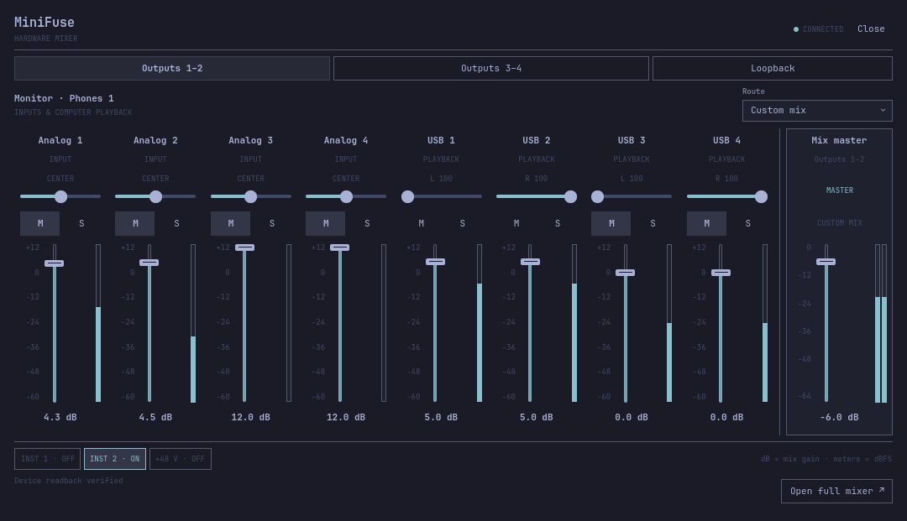

# MiniFuse for Omarchy

**MiniFuse mixer controls and live meters in your Omarchy bar.**

[](https://github.com/srdiogo/omarchy-minifuse/actions/workflows/ci.yml)

Open a compact hardware mixer from the bar, adjust your mix and return to your
work. Part of **MiniFuse for Linux**, with an optional separate
[MiniFuse Control application](https://github.com/srdiogo/minifuse-control)
for full mixer, routing, input and preset management.



*Installed Omarchy panel connected to a MiniFuse 4, showing confirmed controls
and live signal meters.*

[Install](#install) · [Compatibility](#compatibility) · [Get help](SUPPORT.md) · [Contribute](CONTRIBUTING.md)

## A mixer within reach

- Connection status and input-mode indicators in a compact panel.
- Mix tabs, vertical faders, pan, mute/solo and a separate master.
- Available destination routes and live source/mix meters.
- Omarchy colors, fonts and scale, with horizontal scrolling for smaller displays.
- Click the bar icon to toggle; click outside to dismiss.
- Open the full application when you need presets, source membership or input switches.

The panel controls the MiniFuse hardware mixer. Omarchy's PipeWire widget
continues to handle host and application audio. INST/+48 V are read-only
indicators in the panel; their writable controls live in the full application.

## Install

Install the driver and service through [MiniFuse Control](https://github.com/srdiogo/minifuse-control/releases)
or use the [standalone backend](https://github.com/srdiogo/minifuse-backend/blob/main/docs/INSTALL.md)
for a panel-only setup. Panel archives are published in
[Omarchy MiniFuse releases](https://github.com/srdiogo/omarchy-minifuse/releases).

### Backend already installed

Run `minifuse-doctor` in the owning session, then add the plugin through Omarchy:

```sh
omarchy plugin add https://github.com/srdiogo/omarchy-minifuse.git
omarchy plugin enable srdiogo.minifuse
omarchy bar move srdiogo.minifuse --section right
```

The host plugin installer adds the panel only. It has no system-package,
privilege or startup hooks. The MiniFuse Control packages include the backend. See [installation, updates and removal](docs/INSTALL.md).

## Model-support testing

This test revision selects the correct input and native loopback layout for
MiniFuse 1, MiniFuse 2 and MiniFuse 2 OTG. The backend checks the USB firmware
descriptor, exact state and matching driver capabilities before enabling native
loopback. Candidate families are MF1/MF2 1.5.x and OTG 1.0.x; unknown or
unreviewed families stay unavailable. Backend 0.2.1 enables compatible controls automatically. Physical
acceptance is still pending for every new model. MF4 retains its existing
independent mixer. The installer preview linked above predates these additions.

We are looking for owners of MF1, MF2 and MF2 OTG to help with LED checks,
readbacks and minimal Windows USB captures. Follow the backend's
[hardware acceptance guide](https://github.com/srdiogo/minifuse-backend/blob/feature/model-controls/docs/models/TESTING.md).
Static analysis and synthetic frontend fixtures are not physical validation.
See [model layouts and boundaries](docs/MODELS.md) for controls and limitations.

## Compatibility

| Area | Current status |
|---|---|
| MiniFuse 4 | Bounded hardware validation of supported panel controls and meters |
| MiniFuse 1 / 2 / 2 OTG | Experimental native loopback mixer/routes/meters and read-only input indicators; model/firmware gates and hardware acceptance pending |
| Tested hosts | Omarchy 4.0.4 / Quickshell 0.3.1 / Qt 6.11.2; Omarchy 4.0.6 / Quickshell 0.3.2 / Qt 6.12.0 |
| Adapter | Python 3.12–3.14; PySide6 is not required |
| Backend | [MiniFuse Backend](https://github.com/srdiogo/minifuse-backend), installed separately or through the complete kit |

**Development preview.** This revision fixes theme resolution on Qt 6.12; the
released installation preview predates that fix. Other host versions need
acceptance testing. The exact
references are in [host.lock.json](host.lock.json) and
[contract.lock.json](contract.lock.json). Physical-logo activation, effects,
firmware changes and device-storage writes are unavailable.

## Use

Click **MF** in the bar, or focus it and press Enter/Space. The panel reads
device state when it connects; faders and pan apply while moving. Mute/solo
indicators follow confirmed state independently of button focus. Meter samples
expire when stale, and fixed status space keeps messages from moving the faders.

The full application is optional. **Open full mixer & presets** uses its
installed launcher. Preset comparison/restore, membership editing and writable
input switches belong to that application.

## Documentation and community

- [Installation, operation, recovery and removal](docs/INSTALL.md)
- [Support and troubleshooting](SUPPORT.md)
- [Development and tests](docs/DEVELOPMENT.md)
- [Client architecture](docs/PLUGIN.md), [implementation](docs/IMPLEMENTATION.md) and [validation](docs/VALIDATION.md)
- [Changelog](CHANGELOG.md) and [contributing](CONTRIBUTING.md)
- [MiniFuse Control](https://github.com/srdiogo/minifuse-control) and [MiniFuse Backend](https://github.com/srdiogo/minifuse-backend)

## Credits and license

This is an independent community project, not an official Arturia product.
New project-owned material is [MIT licensed](LICENSE). The layout takes
inspiration from [Omarchy360](https://plugins.omarchy.org/plugin.html?id=fenrirrhogar.omarchy360)
and the [official MiniFuse 4 control center](https://downloads.arturia.net/products/minifuse-4/manual/minifuse-4_Manual_1_0_0_EN.pdf),
using original QML components. Protocol and upstream attribution remain in
[the backend evidence record](https://github.com/srdiogo/minifuse-backend/blob/main/docs/mf4/evidence.md).
