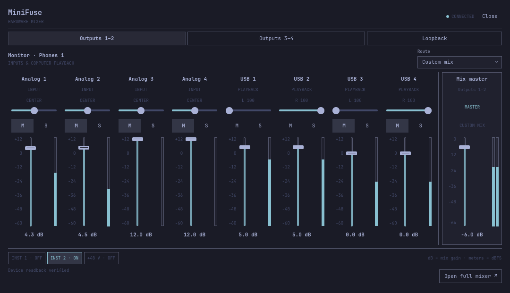

# MiniFuse for Omarchy

Quick hardware mixer controls for the Quickshell-based Omarchy shell. The bar
indicator and layer panel share one client connection to
[mf-service](https://github.com/srdiogo/mf-service). The standalone
[MiniFuse Control application](https://github.com/srdiogo/minifuse-control)
remains a separate project; Omarchy is optional for the platform.

**Status: development preview.** The plugin provides confirmed connection and
input indicators, mix tabs, vertical channel strips with level/pan/mute/solo,
a separate mix master, advertised routes and live signal meters. The full
application owns preset comparison/restore, membership editing and writable
input switches. Hardware validation is bounded to one MiniFuse 4. MF1/MF2 mixer layouts are not inferred.

The layout takes inspiration from the channel strips and monitor separation in
[Omarchy360](https://plugins.omarchy.org/plugin.html?id=fenrirrhogar.omarchy360)
and the [official MiniFuse 4 control center](https://downloads.arturia.net/products/minifuse-4/manual/minifuse-4_Manual_1_0_0_EN.pdf).
It uses original QML components and the active Omarchy palette, fonts and scale.
Sources scroll horizontally on smaller displays while the master stays visible.
Status messages occupy a fixed footer and never move the faders. M/S indications
follow confirmed state independently of keyboard focus. The bar icon toggles the
panel, and clicking outside on any monitor dismisses it.



*Installed Omarchy panel connected to a MiniFuse 4, showing confirmed controls
and live signal meters.*

## Requirements and installation

The tested host is Omarchy 4.0.4-1 with Quickshell 0.3.1 and Qt 6.11.2. Python
3.12–3.14 runs the standard-library socket adapter; it does not require PySide6.
The exact host reference and service contract are recorded in
[host.lock.json](host.lock.json) and [contract.lock.json](contract.lock.json).
Other host versions need acceptance testing.

Install and start the compatible service with the matching administrator-managed
MiniFuse module and session access first. The
[backend workspace](https://github.com/srdiogo/mf-service) provides both
`minifuse-driver-dkms` and `mf-service`, with the core compiled into the service.
Follow [setup on a new machine](https://github.com/srdiogo/mf-service/blob/main/docs/INSTALL.md)
and run `minifuse-doctor` before enabling the plugin. The CLI is not required.
Plugin installation has no package-install or startup hooks.

Review the source, then use the normal host workflow:

```sh
omarchy plugin add https://github.com/srdiogo/omarchy-minifuse.git
omarchy plugin enable srdiogo.minifuse
```

Click **MF** in the bar, focus it and press Enter/Space, or explicitly summon:

```sh
omarchy-shell shell summon srdiogo.minifuse '{}'
```

Device state is read on connection and follows service events. Level and pan
gestures coalesce intermediate movement and preserve the release value. A
bypassed custom mix has its controls disabled with an explanation. Mute/solo
use advertised channel operations; no hardware master-mute selector is invented.
Each strip displays one advertised source. Stereo pair members remain separate
channels, without an invented linked-write policy. Meter subscriptions follow panel visibility after active control work settles;
samples expire after 500 ms without a valid sample.
INST/+48 V are read-only indicators here; their controls live in the full app.

## Development

```sh
python3 tools/check_project.py
python3 -m unittest discover -s tests -v
python3 tools/check_host.py
python3 tools/check_interactions.py
python3 tools/run_preview.py
```

The first four commands use contract fixtures and an isolated host configuration;
they do not change device settings. The last command opens the real panel against
the running service, separately from the user's bar, and can control hardware.
Its operation evidence uses a separate persistent preview state directory.

## Documentation

- [Client architecture and host contract](docs/PLUGIN.md)
- [Installation, operation, recovery and removal](docs/INSTALL.md)
- [Implementation and remaining acceptance work](docs/IMPLEMENTATION.md)
- [Validation evidence and limits](docs/VALIDATION.md)
- [Contribution workflow](CONTRIBUTING.md)

The plugin does not subscribe to physical activation events. A separately
optional desktop agent owns that policy and can summon this plugin when the
backend evidence gate is satisfied. Logo-button support remains unavailable.
Firmware, effects, device-storage writers, direct USB and host audio routing
changes are outside scope. This panel controls the MiniFuse hardware mixer;
Omarchy's PipeWire audio widget remains the host volume/application mixer.

New project-owned material is [MIT licensed](LICENSE). This is an independent
community project. Platform research and upstream protocol attribution remain
in [the backend evidence record](https://github.com/srdiogo/mf-service/blob/main/docs/mf4/evidence.md).
